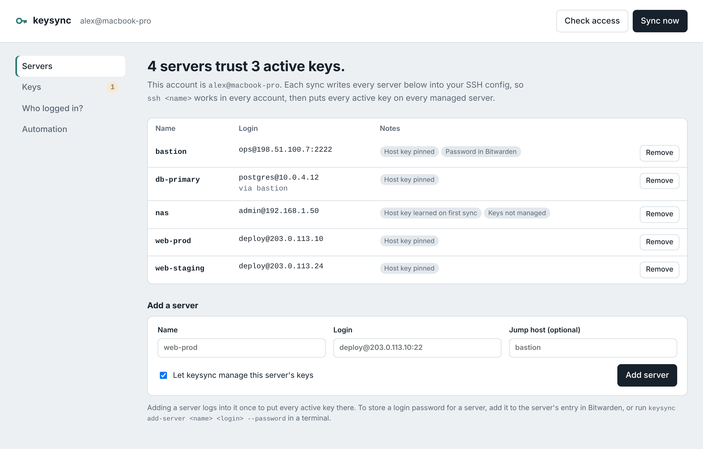

# keysync

**Every account gets its own SSH key. Every server trusts every account. Bitwarden keeps the list.**

MIT license · Python 3.8+ · macOS, Windows and Linux · Bitwarden · Claude Code plugin

New laptop, new user account, new contractor? Logging into your servers shouldn't mean hunting for an old key, copying a private key between machines, or clicking through "authenticity of host can't be established" on every server. keysync does it the other way round. Each account makes its own key, publishes only the *public* half to a folder in your Bitwarden vault, and one sync puts every active key on every server.

- **Accounts are ready on day one.** After a two-minute setup, a fresh account knows every server (`ssh web1` just works), already trusts each server's host key, and is let in at the next sync.
- **Every login is traceable.** Keys are labelled `keysync:<user>@<machine>`. Paste a line from a server's auth log into `keysync whois` and it names the account and computer.
- **Revoke in one command.** Lost laptop? `keysync revoke bob@macbook-air` removes that key from every server.
- **Nothing secret is copied around.** Private keys never leave the account that made them. Bitwarden holds public keys, server details, and optional bootstrap passwords.
- **Your existing keys are safe.** keysync only manages its own marked block in `authorized_keys`, keeps a backup on every server, and refuses to continue if a server's host key unexpectedly changes.
- **A settings page when you want one.** `keysync ui` shows your servers and keys in the browser, turns a log line into the account that logged in, and revokes a key with one click.
- **Runs on macOS, Windows and Linux.** It's one Python file, uses your system's own OpenSSH and the official Bitwarden CLI, and syncs daily on its own.



> An independent open-source tool, not affiliated with Bitwarden or Anthropic.

## Install

### As a Claude Code plugin

Inside Claude Code:

```
/plugin install keysync --marketplace shorconsulting/keysync
```

On an older Claude Code, add the marketplace first: `/plugin marketplace add shorconsulting/keysync`, then `/plugin install keysync@keysync`.

Then ask Claude things like *"add my server web1 at deploy@10.0.0.5"*, *"which servers can this account reach?"* or *"who logged in with this key?"*. Claude never types your Bitwarden password. The one-time setup runs in your own terminal, as shown below.

### One-time setup (each account, each computer)

Download or clone this repo, then run the installer from it:

| | Command |
|---|---|
| **macOS / Linux** | `bash install.sh` |
| **Windows** (PowerShell) | `powershell -ExecutionPolicy Bypass -File .\install.ps1` |

The installer asks before each step. See [Setup details](#setup-details) for what each step does on each system.

## How it works

```
 Mac account A ─┐                      ┌─► server 1 ~/.ssh/authorized_keys
 Mac account B ─┼─► Bitwarden "keysync" ─┼─► server 2   (a marked block holding
 Mac account C ─┘   keys + servers     └─► server 3    every active key)
```

`keysync sync` does three things:

1. **Publishes** this account's public key to Bitwarden, the first time only.
2. **Writes** `~/.ssh/keysync_config` (one `Host` entry per server) and `~/.ssh/keysync_known_hosts`, and adds one `Include` line at the top of `~/.ssh/config`.
3. **Logs into every server** and rewrites a block in `~/.ssh/authorized_keys` that starts `# BEGIN keysync` and ends `# END keysync`, so it holds exactly the active keys. Keys outside that block are never touched, so existing access keeps working.

To get onto a server it hasn't reached before, keysync tries this account's own key first, then any key the account already has (`~/.ssh/id_*` or the SSH agent), then the password stored in Bitwarden. So adding a new account only needs one account that can already get in, or one stored password.

## Setup details

The installer checks for what's missing, offers to install it, then asks before importing servers, before touching any server, and before scheduling the daily sync. Run it first from an account that can already reach your servers.

**macOS**
```bash
bash "/path/to/keysync/install.sh"
```
Needs Python 3 (run `xcode-select --install` if it's missing). Installs the Bitwarden CLI with Homebrew or npm if needed.

**Windows 10/11** (PowerShell)
```powershell
powershell -ExecutionPolicy Bypass -File "C:\path\to\keysync\install.ps1"
```
Needs the built-in **OpenSSH Client** (Settings > System > Optional features). Offers to install Python and the Bitwarden CLI with `winget`. `-ExecutionPolicy Bypass` applies to this one run only; it doesn't change your system's policy.

**Linux**
```bash
bash /path/to/keysync/install.sh
```
Needs `python3` and `openssh-client` from your package manager. Installs the Bitwarden CLI with npm or snap if needed.

Afterwards, open a new terminal window. The `keysync` command works the same on all three systems.

| | macOS | Windows | Linux |
|---|---|---|---|
| `keysync` command | `~/.local/bin/keysync` | `%USERPROFILE%\.local\bin\keysync.cmd` | `~/.local/bin/keysync` |
| Daily job | launchd (runs on wake if the Mac was asleep) | Task Scheduler task "keysync" | cron |
| Unattended Bitwarden session | macOS Keychain | file encrypted for your Windows user (DPAPI) | file readable only by you |
| Bitwarden CLI | `brew install bitwarden-cli` | `winget install --id Bitwarden.CLI -e` | `npm install -g @bitwarden/cli` |

Every account signs in to the **same Bitwarden account** (or an organization collection they all share). Without the installer, run `python3 keysync.py setup --import-config` (on Windows: `py -3 keysync.py setup --import-config`), then `keysync schedule`.

## Settings page

```bash
keysync ui
```

Opens a page in your browser to add and remove servers, see every account's key, revoke or reactivate a key, look up who made a login, and set the daily sync. It never asks for your Bitwarden master password: if the vault is locked, run `keysync unlock` in a terminal and the page picks it up. It runs only on your own computer (127.0.0.1) while that terminal window is open, and its link carries a one-time code, so other user accounts on the same computer can't use it.

## Everyday commands

| Command | Does |
|---|---|
| `keysync add-server web1 deploy@10.0.0.5` | Add a server and push all keys to it. Add `--password` to store a login password for first-time access, `--proxy-jump bastion` to go through a jump host, or `--no-manage` to list it without changing its keys |
| `keysync sync` | Pull from Bitwarden and push keys to every server |
| `keysync check` | Which servers can this account reach with its own key? |
| `keysync servers` / `keysync keys` | List servers / every account's key and status |
| `keysync revoke bob@macbook-air` | Revoke a key everywhere (a lost laptop, a compromised account). `reactivate` undoes it |
| `keysync whois "Accepted publickey for root … SHA256:…"` | Which account made this login? Paste the line from the server's auth log |
| `keysync import-config` | Import the hosts in `~/.ssh/config` into Bitwarden |
| `keysync remove-server web1` | Remove a server from Bitwarden. Keys already on the server stay |
| `keysync unlock` / `keysync lock` | Unlock Bitwarden for unattended syncs / lock it and stop them |
| `keysync ui` | Open the settings page in your browser |

You can also edit everything directly in Bitwarden: the `keysync server: …` login items and the `keysync key: …` notes. Set a key's `status` field to `revoked`, or a server's `manage_keys` field to `no`.

## Security notes

- **Unattended syncs.** The daily job needs an unlocked vault. `keysync unlock` stores the Bitwarden session (macOS Keychain, a DPAPI-encrypted file on Windows, a mode-600 file on Linux) until you run `keysync lock`. If the vault is locked, the job stops and shows a notification instead of prompting.
- **Who can change server access.** Anyone who can unlock this Bitwarden vault can add keys to your servers. Protect the vault with a strong master password and two-step login.
- **Passwords.** Stored server passwords are used only when no key works. They're handed to `ssh` through a private helper and never written to disk.
- **Host keys.** These are learned the first time any account connects, then stored in Bitwarden, so every other account trusts the right key from the start. If a server's key later changes, sync stops for that server and warns you. That happens after a rebuild, or in an attack. If you rebuilt the server, clear its `host_keys` field in Bitwarden and sync again.
- **"The server closed the connection before login."** Servers running OpenSSH 9.8 or later briefly block an address after several failed logins, which can happen right after a brand-new account tries its key. Wait a few minutes and sync again.
- **Values from the vault are checked.** Server names, hosts, users, jump hosts, host keys and public keys must be plain values before they reach `~/.ssh/config`, an ssh command line or `authorized_keys`. An entry that could carry an ssh option (a `ProxyCommand`, say, or a key with a `command=` prefix) is skipped with a warning, so someone who can edit the vault folder still can't run commands on your computers.
- **Recovery.** A server's previous `authorized_keys` is kept as `authorized_keys.keysync-bak`. If a rewrite would lock out the account doing the sync, keysync restores the previous file automatically.

## Privacy and data

The full [Privacy](PRIVACY.md) policy is in `PRIVACY.md`. In short: keysync has no telemetry and no server of its own. It talks only to:

- **Your Bitwarden vault**, through the official Bitwarden CLI (`bw`) signed in as you: it reads and writes items in one folder (default `keysync`) holding public keys, server details and optional bootstrap passwords.
- **The SSH servers you list**, through your system's own `ssh`, to update the keysync block in `authorized_keys`.
- **Your own computer**: `~/.ssh/keysync_config`, `~/.ssh/keysync_known_hosts`, one `Include` line in `~/.ssh/config`, the key it creates, and its state in `~/.keysync/`. The settings page listens on 127.0.0.1 only, behind a random per-run token.

Private keys never leave the account that made them, and stored passwords are handed to `ssh` through a private helper without being written to disk. The source is one readable Python file, `keysync.py`.

### Credentials it reads from your computer, and why

keysync's job is to manage SSH access from your own accounts, so it has to use credentials that already exist on your computer. It reads only these, and passes each only to the program shown:

| Credential | Where it comes from | Used by |
|---|---|---|
| The Bitwarden **session token** made by `keysync unlock` (never your master password) | `BW_SESSION` if you set it; else the macOS Keychain item "keysync Bitwarden session", the DPAPI-encrypted `~/.keysync/bw_session.dpapi` on Windows, or the mode-600 `~/.keysync/bw_session` on Linux | the `bw` CLI, so the daily sync can run unattended. `keysync lock` deletes it |
| This account's **keysync SSH key**, `~/.ssh/keysync_ed25519` | created by keysync on this account | your `ssh`, to log in to your servers |
| Your **existing SSH keys** (`~/.ssh/id_ed25519`, `id_ecdsa`, `id_rsa`, or the SSH agent) | already on this account | your `ssh`, only to reach a server the first time, before the keysync key is on it |
| A server's optional **bootstrap password** | the server's item in your Bitwarden folder | your `ssh`, through a private helper, never written to disk |

These can't be Claude Code `userConfig` values. The session token changes every time you unlock, and the master password is typed only into your own terminal. Claude never sees it. Nothing above is sent anywhere except to your own `bw` CLI and your own servers.

## Tests

```bash
bash tests/run_tests.sh
```

Runs on macOS or Linux. Starts a real `sshd` on 127.0.0.1 and uses a stand-in Bitwarden vault. Two simulated accounts go through setup, first access via an existing key, deployment, traceability, revocation, and a tampered host key plus Windows command and path checks (22 checks). It needs `ssh`, `sshd` and `python3`. It temporarily adds test keys to the current user's `~/.ssh/authorized_keys`, then restores the original.

`bash tests/ui_tests.sh` checks the settings page and the checks on values from the vault (15 checks). It needs only `python3` and `curl` and contacts no server.

On Windows, run `py -3 tests\windows_check.py`. It uses a throwaway home folder with spaces in its path and a stand-in `bw.cmd`, and drives this computer's real OpenSSH client, PowerShell and Windows data protection: setup, the generated SSH config as `ssh` reads it, a login attempt against a closed local port, the password helper, the encrypted session file, a locked vault, revoke, whois, the installer's syntax and the settings page. It never contacts a server or your real vault. Add `--real-scheduler` to also create a real scheduled task for a moment and delete it again.

**Windows status:** first run on a real PC (Windows 11, OpenSSH 9.5) on 2026-10-12: 6 checks failed and were fixed, and the re-run passed every check. Windows OpenSSH refuses a config or key file that anyone besides you, SYSTEM and Administrators can read, and files inherited extra entries (OWNER RIGHTS) from their folder, so keysync now sets those files' permissions itself. A locked vault started a password prompt nobody could see, because Windows reports "no input" as a terminal; it now stops with "Bitwarden vault is locked". Signing in with a stored password needs OpenSSH 8.4+. Recent Windows 11 builds have it; older Windows 10 builds ship 7.7, where keysync says so and skips that step.
